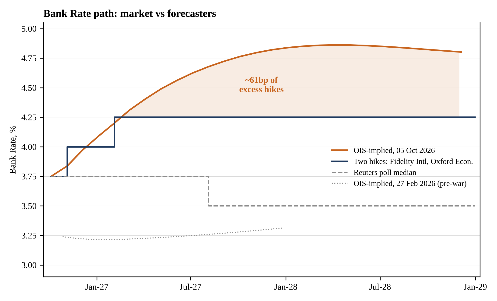
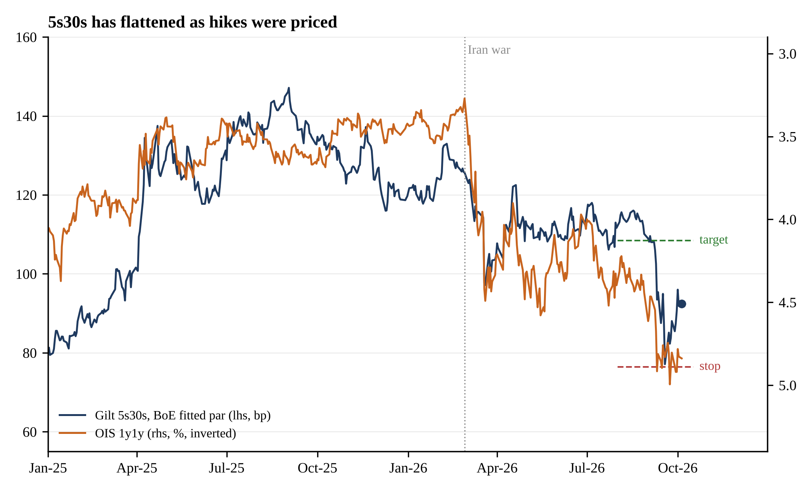
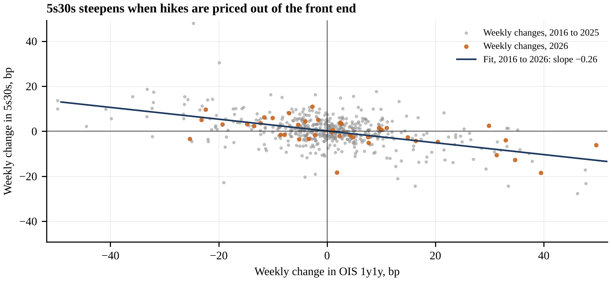

# UK gilt 5s30s steepener

A trade idea on the UK gilt curve, with the analysis behind it: ten years of Bank of England curve data, a regression that calibrates the target, and a rich/cheap screen that picks the bonds.

**Market data to 5 October 2026.** This is a dated research note, not a live recommendation.

- [One-page trade idea (PDF)](report/UK_Gilt_5s30s_Steepener_One_Pager.pdf)
- [Full report: trade idea, methodology, evidence log and code (PDF)](report/UK_Gilt_5s30s_Steepener_Full_Report.pdf)
- [Analysis notebook, with outputs](notebooks/Gilt_5s30s_Steepener_Analysis.ipynb)

## The trade

| Term | Detail |
|---|---|
| Expression | Buy UKT 4% Oct-2031, sell UKT 5⅜% Jan-2056, DV01-neutral |
| Entry | 96bp |
| Target | 112bp |
| Stop | 80bp |
| Risk/reward | 1.0x on the spread, 1.5x with six months' carry and roll |
| Carry and roll | +4.3bp a quarter |
| Horizon | 3 to 6 months |

## The thesis

OIS was pricing about 110bp of Bank of England hikes by the end of 2027 for an energy shock that was not reaching wages. As that pricing fades the five-year should rally, while fiscal, supply and global premia keep the 30-year sticky, so the curve steepens from the front.

## What the data showed

- **Too many hikes priced.** OIS priced 32bp of hikes by end-2026 and 109bp by end-2027, peaking at 4.86% in spring 2028, about 61bp above a two-hike path to 4.25%. In February the same curve priced 44bp of cuts.
- **The flattening tracked hike pricing.** Fitted 5s30s fell from 126bp on 27 February to 92bp as OIS 1y1y rose 157bp. Weekly changes correlated at −0.6 in 2026.
- **A calibrated target.** Each 10bp fall in 1y1y has steepened 5s30s by 2.6bp (weekly changes, 2016 to 2026, t = −9.1). A 4.25% peak implies about +15bp.
- **A repricing trade, not mean reversion.** 5s30s sat at the 62nd percentile of ten years but the 5th of the past year. OIS forwards averaged 4.78% over 2028 to 2031, so no easing was priced after the peak.







## What the analysis does

1. Loads daily Bank of England OIS and nominal government liability curves from 2016 to 2026.
2. Builds the fitted par 5s30s from the zero curve, after checking the rates are continuously compounded.
3. Reads the market-implied Bank Rate path from instantaneous OIS forwards.
4. Regresses weekly changes in 5s30s on changes in OIS 1y1y, with Newey-West standard errors, to calibrate the target.
5. Sizes the stop from realised volatility and measures carry and roll from the fitted curve.
6. Sizes the legs DV01-neutral and screens every conventional gilt rich or cheap against the Bank's curve.

## Repository layout

```
report/      one-page trade idea and the full report (PDF)
notebooks/   analysis notebook, executed with outputs
figures/     charts used in the report
data/        where the Bank of England files go (not included)
```

## Reproduce it

```
pip install -r requirements.txt
```

Download the six spreadsheets listed in [data/README.md](data/README.md) into `data/`, then open the notebook and run all cells. The first run takes a minute or two and caches the parsed curves to `outputs/`.

## Data and sources

- **Curves:** Bank of England yield curve statistics, OIS and nominal government liability curves, daily. Not redistributed here; see [data/README.md](data/README.md).
- **Gilt prices, durations and yields:** giltsyield.com, close on 5 October 2026. The snapshot is embedded in the notebook.
- **Macro statistics:** each is listed with its source in the evidence log, Appendix G of the full report.

## Limitations

- **Fitted curves.** The Bank's curves are fitted, so bond-level spreads differ slightly from fitted ones.
- **Smoothed forwards.** Instantaneous OIS forwards are smoothed and show no discrete steps at meetings.
- **Co-movement, not causation.** The regression's R-squared is 0.21.
- **Carry and roll assumptions.** They assume an unchanged curve and general collateral funding.

The full discussion is in Appendix H of the report.

## Disclaimer

For research and discussion only. Not investment advice.

## Author

Ayush Singh, BSc Mathematics and Economics, London School of Economics. a.singh121@lse.ac.uk

The code is released under the MIT licence (see [LICENSE](LICENSE)). Data remain subject to their providers' terms.
